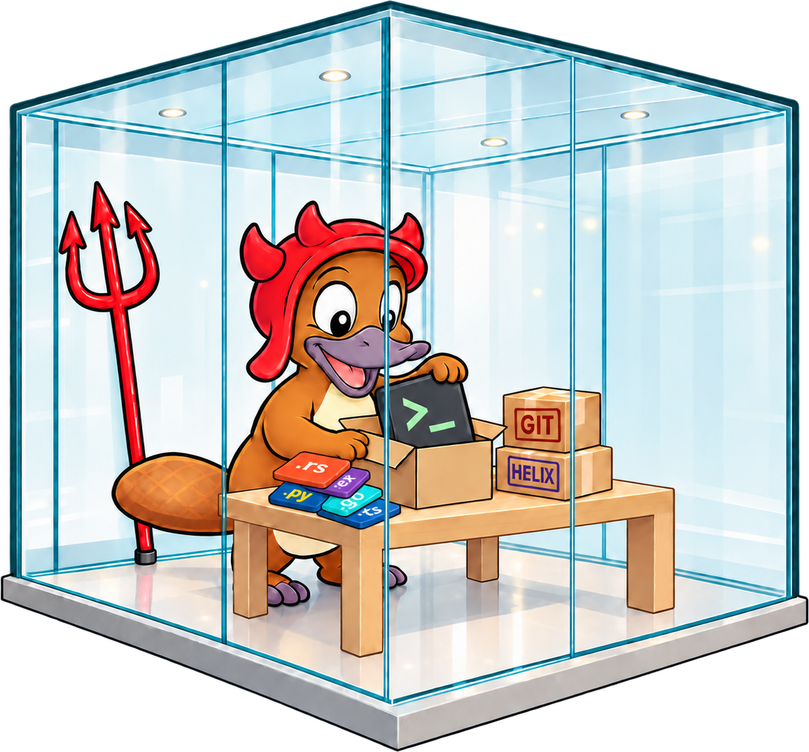

# HexBox

<p align="center">
  
</p>

HexBox gives Nix on your Mac a way to build Linux packages. It's a
`nix-darwin` module that runs a small `aarch64-linux` machine using Apple's
`container` tool, and tells Nix to send Linux builds there. The machine boots
when a build needs it, shuts itself down when idle, and keeps its `/nix` store
in between.

- Website: <https://robertderose.github.io/nix-hex-box/>
- Documentation: <https://robertderose.github.io/nix-hex-box/docs/>

## Quick start

You need an Apple silicon Mac, a flake-based `nix-darwin` configuration, and
Apple's `container`, installed however you like (`brew install container`,
`mise use -g container`, or Apple's package) and started with
`container system start`.

Add HexBox to your flake:

```nix
{
  inputs.hexbox.url = "github:RobertDeRose/nix-hex-box";

  outputs = inputs: {
    darwinConfigurations.my-host = inputs.darwin.lib.darwinSystem {
      system = "aarch64-darwin";
      modules = [
        inputs.hexbox.darwinModules.default
        {
          services.container-builder = {
            enable = true;
            memory = "8G";
          };
        }
      ];
    };
  };
}
```

Then switch, and try a build:

```bash
sudo darwin-rebuild switch --flake .#my-host
hb builder repair
hb builder test
```

The first `hb builder repair` downloads the builder image, so it takes a few
minutes. The [installation guide](https://robertderose.github.io/nix-hex-box/docs/getting-started/installation)
explains each step.

## Status

HexBox works, but it's young. A smaller,
systemd-based builder image is planned once Apple's `container` runs larger
systemd images reliably.

## The builder image

By default, the builder runs `ghcr.io/robertderose/nix-hex-box/hexbox-builder:latest`:
Alpine 3.22 with OpenSSH, sudo, and Lix. GitHub Actions rebuilds `latest`
weekly, so Alpine security fixes reach new and recreated machines. A rebuild is
skipped until the Lix release it uses is at least seven days old. When the
image definition changes on `main`, the workflow also publishes a versioned tag,
such as `alpine-3.22-lix-2.95.2-2`, for anyone who wants to pin one.

## Working on HexBox

- The module is `modules/container-builder.nix`. The flake exports it as both
  `darwinModules.default` and `darwinModules.container-builder`.
- The `hb` helper's source is `scripts/hb.sh`. `assets/hb.sh` is built from it
  with `argc --argc-build`; edit the script, not the built copy.
- The website is plain HTML in `site/`. The documentation is a Docusaurus site
  in `docs/`, with its pages in `docs/src`. `mise run pages:build` assembles
  both into `_site/` the way GitHub Pages publishes them, and
  `mise run pages:serve` previews the result.
- `docs/spec.md` describes the design in more detail.
